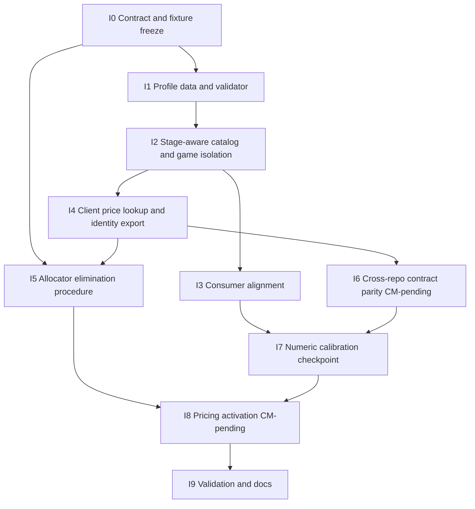
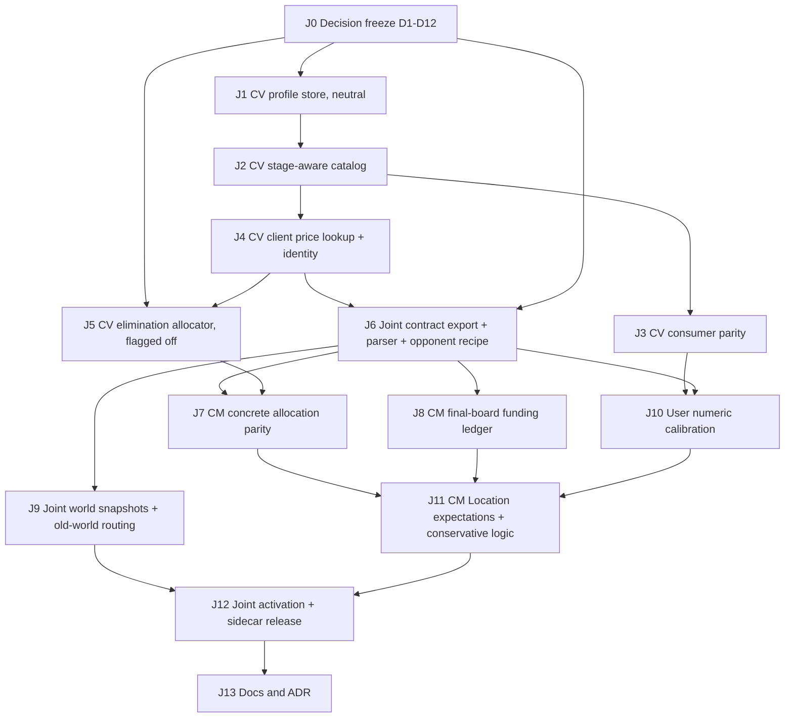

# Board-aware APMW material values: integration plan

Status: needs-triage
Type: iterable plan (spec + dependency-ordered iterations)
Source revision: ChessV `03bf26b` (unchanged from the analysis baseline)
Authority: coordinator design plan
`C:\Users\aaedi\.copilot\session-state\2181993b-955f-43a7-b1fb-228e6df19b38\plan.md`
and its `files\` evidence (`material-<geo>.json`, `material-comparison-<geo>.json`,
`material-full-suite.log`).

This document plans work. It authorizes no production edit, contract change,
pull request, or release. The ChecksMate (`chesslogic/Archipelago`,
`worlds\checksmate`) report is in `checksmate-evidence.md` (evidence revision
`checks_mate` `0772bac`). §11 merges both repositories into one iteration
order; it supersedes the **CM-pending** markers in §6.

Authority reconciliation, 2026-10-26:
[ADR0024](../../docs/adr/0024-seeded-hierarchical-allocation.md) and the
[current frontier](../adr-implementation-design/engineering-closure.md#current-authority-and-frontier)
record the relationship between this plan and the October 21 successor.
D3/D5/D6 are later author refinements, not discarded proposals.
The October 25 user decision retains later elimination, upgrades, and surplus behavior under the guarantee-preservation rule.
Every purchase must preserve the promised prefix and feasible mandatory completion, including Castler funding and compatible placement.
A standalone affordable purchase is rejected if it makes mandatory completion impossible.
Exact algorithms, typed funding/prices, and refund exceptions remain open.
This plan does not silently authorize a replacement of the retained Castler, protected-base, or certified-access obligations.

## 1. Problem

APMW registers one MG/EG pair per piece in one place
(`ChessV.Games\MiscellaneousGames\ApmwPieceCatalog.cs`, private constructor).
Every APMW board type (`ApmwSixByEightChess`, `ApmwChessGame` 8x8,
`ApmwGrandChess` 10x8, `ApmwTenByTenChess`, `ApmwTwelveByTenChess`) calls the
same `ApmwPieceCatalog.Create()` from `ApmwChessGame.earlyPopulatePieceTypes()`.
Piece strength relative to a Pawn changes with board size, so one table cannot
price spending, evaluation, Gems, and Location expectations correctly on every
board.

## 2. Confirmed scope

| Item | Decision |
|---|---|
| Mode | Fundamental only. Legacy is not redesigned. |
| Geometries | Exactly `6x8`, `8x8`, `10x8`, `10x10`, `12x10`. 12x12 is rejected (ADR 0002). No arbitrary tall-board obligation. |
| Value form | Explicit per-piece, per-geometry MG/EG profiles. No runtime mobility formula. |
| 8x8 | Every existing 8x8 MG/EG value stays identical. |
| Item credits | Fixed denominations (`ItemGenerationValues`, contract `ExpectedMaterial`). Pool quantity/total can grow. |
| Spending | Concrete MG affordability. 8x8 allocation outputs may change. |
| Selection | Resolve concrete identities before looking up prepared-board prices. Families express selection preferences, not per-entry spending budgets. |
| Price board | Spend at the prepared board's values. Fund the world against the opposing army on its final board. |
| Locations | Material expectations use board-specific opposing costs. |
| Player Location access | New Fundamental worlds use concrete board-specific active BOARD material plus unchanged supported-Pocket credit. A conservative guarantee remains required. |
| Slots | Received Chessmen tokens remain fixed. D3 permits post-prefix derived Pawns from remaining material, not new received tokens. |
| Consumers | AI evaluation, pocket Gems (existing `MG/100` integer conversion, no new rounding or minimum), True Fork comparison, and Properties all read the prepared game's values. |
| Mutation | Resolve fresh game-bound values before board accounting. Never mutate initialized shared `PieceType` instances. |

Accepted allocation rule: keep the seeded exhaustive prefix until the first
unaffordable concrete draw. After that, filter both families and concrete
types by affordability and restrictions. Seed counters advance and never reset.
A failed draw consumes its position. Later family draws remap into surviving
families. A family is pruned only when no eligible type fits. Existing
priorities and proportions remain where they apply. No retry loop and no
optimal-knapsack claim.

The October 26 concrete-selection clarification requires one shared `(profile identity, stage_id, type_id) -> MG/EG` lookup.
The allocator and game consume the same versioned profile.
Affordability uses concrete MG, not labels such as 3/5.
Families retain existing classification, semantic Pocket, and accounting roles outside this selection question.
Roles and Castler capability remain identity-backed.
The user's 300/525 examples do not select numeric prices, a new palette, or family reclassification.

## 3. Current state (rev 03bf26b)

| Concern | Location | Observation |
|---|---|---|
| Value registration | `ApmwPieceCatalog.cs` ctor (~19-90) | One hard-coded MG/EG pair for each of 43 types (Pawn 100/125, Knight 325/325, Bishop 325/350, Rook 500/550, Queen 950/1000, Gardener 250/250, Checkers 40/95, ...). |
| Construction | `ApmwPieceCatalog.Create()`, `BindTo(game)`, `Publish(ApmwCore)` | Fresh instances per game, then family sets are written into the process-global `ApmwCore` singleton. `EnsurePublished()` republishes only when incomplete. |
| Board type | `ApmwChess.cs` `SetOtherVariables()` (~375) -> `earlyPopulatePieceTypes()` (~496) | Catalog is created and published before `GeometryAwarePlayerPieceSetProvider(NumFiles, NumRanks)` runs. The game ctor (~142-153) also clears the `ApmwCore` sets. |
| Geometry identity | `ApmwProfiles.cs` `ApmwGeometryProfile.StageId` (`"FxR"`) | Every APMW board type overrides `ApmwProfile`. `ApmwProfiles.Stages` omits 6x8 and still lists 12x12. |
| Ordinary variants | `GenericChess.cs` and `Generic*x*` `AddPieceTypes` | Pawn stays 100/125 at every size; Knight/Bishop/Rook/Queen vary (for example 10x10: Q1000/1100, R550/600, B400, N275). Precedent for absolute engine units with Pawn fixed at 100. Not authority for APMW. |
| Mutable values | `ChessV.Base\PieceType.cs:61-62` | `MidgameValue`/`EndgameValue` are settable ints. |
| Engine consumers | `Board.cs` 896-962, `Game.cs` SEE 2361-2432, `MoveList.cs`, promotion/capture rules, `BareKingRule` | Read the bound game's `PieceType`. |
| Gems | `CardDropRule.cs:94-143` | `MidgameValue / 100` for legality, generation, undo. |
| True Fork | `APMW.Client\LocationHandler.cs:693` | Compares attacker MG + 100 with target MG. |
| Properties | `ChessV.GUI\Controls\PieceInfoControl.cs:53-54` | Shows MG/EG. |
| Client spending | `OwnedRosterGeneration.cs` `PiecesForFamily` (~818), `FamilyPieceChooser.Choose` (~365-410), `ConcreteEvaluationAdjustment` (~783) | Options come from global `ApmwCore` sets, ordered by Name then Notation. An empty type-limit pool falls back to all options. |
| Family credits | `ItemGeneration.cs:9-23` `ItemGenerationValues`; `ApmwContractV2.cs:54-70` `ExpectedMaterial` | Pawn 100, Weak 75, Minor 300, Major 485, Jack 700, Queen 900, Amazon 1300, Castler 500, ... Fixed. |
| Contract/stage list | `ApmwContractV2.cs:22-23,43` | v2.0; `StageOrder` {8x8,10x8,10x10,12x10,12x12}; no 6x8. v4 draft stage order is exactly the five supported stages. |
| Export | `shared-data-contract-v4.md:184` | Army artifact proposes `catalog_material {midgame, endgame}` per piece (single table). |
| World costs | `world-cost-snapshot-v1.md`, ADR 0016 | Per-world frozen snapshot with sha256 bindings; the client never recalibrates. |
| Pawn-stage allowance | `PawnGeneration.GeneratePawns` | The allowance is +45, not +70. The user selected this amount to prevent an extra Checkers piece at the start. See D4. |

## 4. Value domains (keep separate)

| Domain | Unit | Owner | Varies by geometry? | Used by |
|---|---|---|---|---|
| Item family credit | Fixed integer denominations | `ItemGenerationValues` / contract `ExpectedMaterial` | No | Funding, generator pool totals |
| Concrete spending price | Absolute engine integer MG | Material profile (§5) | Yes | Allocation affordability, `ConcreteEvaluationAdjustment` |
| Evaluation value | Absolute engine integer MG and EG | Material profile (§5) | Yes | Search, SEE, ordering, Properties, True Fork |
| Gem value | `MG / 100`, integer division | `CardDropRule` (unchanged formula) | Through MG only | Pocket drops |
| Opposing-army cost | Absolute engine integer MG of CPU types on the final board | Material profile export -> ChecksMate | Yes | Location material expectations |
| Fundamental player access material | Concrete active non-primary BOARD material `B` plus supported-Pocket credit `H` | Prepared profile and conservative projection | Through `B` | Sound Location bound `L_M` for new Fundamental worlds |
| Pawn-relative ratio | Derived `value / Pawn MG` | Reporting and calibration only | n/a | Never stored, never normalized per consumer |

The profile stores absolute engine integers only. Ratios are analysis output.
No consumer divides by a board's Pawn value or renormalizes values on its own.
D1 resolves the Pawn value to 100/125 on every geometry.
This fixed unit does not supply the unresolved typed allocation ledger.

On October 26, the user selected concrete board-specific player values for Fundamental Location access.
Thus `L_M` must be sound against `B + H`, not nominal family `E + H`.
Pocket credit remains `H = min(S, floor(B/2), 300*C)`.
`S` is supported semantic Pocket material, and `C` is the supported Pocket count.
Pocket support/credit rules, protected funding, and Legacy remain unchanged.
This choice does not prove actual `B + H` monotone or accept numeric profile values.
Conservative bounds and extension coverage remain PM proof obligations.

## 5. Storage and registration recommendation

### 5.1. Choice

Use one immutable, versioned **APMW material profile** owned by ChessV
`ChessV.Games`, keyed by `(stage_id, type_key)`. It holds a complete MG/EG
table for each supported stage. Authors may write it as an 8x8 baseline plus
per-stage overrides, but the loader expands it to complete tables and hashes
the expanded form. Runtime code never sees a sparse table and never falls back
silently.

Why this choice:

- The board type already owns `ApmwGeometryProfile.StageId`; the material
  table is a peer lookup keyed by that ID, not a new class per board.
- Absolute engine integers match every current consumer and the ordinary
  variants. No consumer changes its arithmetic.
- Complete expanded tables make "unchanged on this board" an explicit, hashed
  fact instead of an absence.
- Separating profile data from `PieceType` construction lets the client price
  a stage without creating or publishing a game.

Rejected alternatives:

| Alternative | Reason |
|---|---|
| Per-board-class `AddPieceTypes` overrides (ordinary-variant style) | Scatters values across five classes, gives no exportable identity, and the client cannot price a stage without a game. |
| Pawn-relative ratios with per-board Pawn scaling | Requires every consumer to normalize; conflicts with fixed item credits and Gem `MG/100`. |
| Mutating `MidgameValue` on shared instances after creation | Forbidden by scope; contaminates previews and concurrent games. |
| Runtime formula (mobility x board area) | Rejected by scope. |
| Sparse overrides consulted at runtime | Silent fallback hides missing entries; hash would not describe resolved values. |

### 5.2. Proposed data shape

Proposed, not existing, names. Embedded C# data is the simplest owner; a JSON
resource is acceptable only if B1's Army artifact work already provides a
loader (decide in I1).

```text
ApmwMaterialProfile {
  profile_id: "apmw-material"            // stable
  revision: int                           // increments on any value change
  stage_order: ["6x8","8x8","10x8","10x10","12x10"]
  baseline_stage: "8x8"
  stages: {
    "<stage_id>": {
      "<type_key>": { midgame:int>=0, endgame:int>=0 }   // complete after expansion
    }
  }
  sha256: canonical hash of the expanded table (computed, not authored)
}

Authoring form (optional):
  baseline: { "<type_key>": {mg,eg} }                     // exactly today's constants
  overrides: { "<stage_id>": { "<type_key>": {mg,eg} } } // only differences
```

Example (illustrative keys; numbers are today's 8x8 constants, not proposals):

```text
stages["8x8"]["Knight"]   = { midgame:325, endgame:325 }
stages["8x8"]["Gardener"] = { midgame:250, endgame:250 }
stages["10x10"]["Knight"] = { midgame:<calibration D2>, endgame:<calibration D2> }
```

### 5.3. Keys

- **Stage key:** `ApmwGeometryProfile.StageId` (`"6x8"`, `"8x8"`, `"10x8"`,
  `"10x10"`, `"12x10"`). Same strings as the v4 `stage_order`.
- **Type key:** the v4 `type_id` from B1 (D8). Do not key by the
  one-character board `Notation`, display `Name`, interim constants, or
  reflection on field names. All 43 entries in `ApmwPieceCatalog` have
  distinct notations today, but notations are not persistence keys.

### 5.3a. Rejected key proposal (D8)

The one-character board `Notation` was considered as the type key, because
all 43 entries in `ApmwPieceCatalog` have distinct notations (`K`, `W`, `Z`,
`P`, ..., `Ŧ`). The user declined it on 2026-10-23. A notation key would make
each notation permanent, and a notation change would revise the profile and
stored worlds.

### 5.4. Owner and layering

| Layer | Responsibility |
|---|---|
| `ChessV.Games` `ApmwMaterialProfiles` (NEW, beside `ApmwPieceCatalog`) | Owns data, expansion, validation, hash, and a pure `Resolve(stageId, typeKey) -> (mg, eg)` lookup. No `Game`, no `ApmwCore`. |
| `ApmwPieceCatalog.Create(stageId)` | Constructs fresh `PieceType` instances with resolved values. Removes the hard-coded pairs from the constructor. |
| APMW board types | Pass `ApmwProfile.StageId`; no per-class value code. |
| `ApmwCore` publish | Publishes family membership only. Prices never come from the last-published instances. |
| `APMW.Client` allocation, previews, sidecar adapter | Price through the pure lookup for the captured prepared stage. |
| Export tooling | Emits the expanded profile and its identity into the Army artifact (§5.7). |

### 5.5. Resolution timing

1. The board type knows its `ApmwGeometryProfile` before
   `SetOtherVariables()`.
2. `earlyPopulatePieceTypes()` calls `ApmwPieceCatalog.Create(StageId)`. Values
   are set at construction, before `BindTo`, `Publish`, `AddPieceTypes`, and
   any board accounting.
3. After construction no code writes `MidgameValue`/`EndgameValue` on APMW
   types. A test asserts this.
4. The client captures the prepared stage once per setup and prices every
   allocation and preview with that stage. It does not read values from
   `ApmwCore` instances, which may belong to another game or preview.

### 5.6. Validation (load time, fail fast)

- Stage set equals exactly the five supported stages; 12x12 and unknown stages
  throw (ADR 0002).
- Every catalog type key exists in every stage; no extra keys.
- Values are nonnegative integers. Royal types keep their existing values
  (SEE treats royals separately; no change).
- The expanded `8x8` table equals today's constants exactly (golden test).
- Optional calibration guards, once D2 is accepted: declared ordering
  constraints (for example a family member's MG within its family's accepted
  range). Do not invent these before D2.
- The hash is reproducible from canonical JSON (reuse S0
  `ApmwCanonicalJson` when it exists).

### 5.7. Versioning and export (ChecksMate)

- Identity: `(profile_id, revision, sha256)`.
- Export: extend the v4 Army artifact. Replace the single per-piece
  `catalog_material` with per-stage values, or add a sibling
  `material_profile { profile_id, revision, sha256, stages{stage_id:{type_id:{midgame,endgame}}} }`.
  The Army artifact hash then covers the profile. Choice belongs to the
  contract owner (I6, **CM-pending**).
- World binding: a generated world records the profile identity in its world
  bindings beside contract/army/location-profile hashes
  (`world-cost-snapshot-v1.md`). The client refuses a world whose recorded
  profile identity differs from its own. It never reprices a frozen snapshot.
- Old worlds: ADR 0005 already rejects pre-0.4.0 contracts. Within the new
  contract, any value change increments `revision` and changes the hash, so an
  older 0.4.x world fails binding instead of being silently repriced.

### 5.8. Complete tables vs baseline + overrides

Runtime and export: complete expanded tables only. Authoring: baseline plus
overrides is allowed because most entries may stay at 8x8 values, but each
"same as 8x8" on a non-8x8 stage must survive review as a deliberate entry in
the expanded, hashed output. The calibration checkpoint (I7) reviews the
expanded table, not the override list.

### 5.9. Ordinary-variant migration

No migration. Ordinary variants keep their `AddPieceTypes` values and never
read the APMW profile. Acceptance: existing ordinary-variant tests and
`material-full-suite.log` baselines remain unchanged.

## 6. Iterations

Each iteration ends in a mergeable, test-backed state. I1-I4 are
behavior-neutral foundations: every stage resolves to today's 8x8 values.
Activation (I5 onward) is gated.



| ID | Goal | Touched components | Acceptance | Rollback/compat gate |
|---|---|---|---|---|
| I0 | Freeze identity, fixtures, open decisions | `.scratch\board-aware-material-values\`, contract v4 draft (proposal only) | Fixtures F1-F6 (§7) written with expected outputs; D-list (§9) acknowledged | Planning only |
| I1 | Add `ApmwMaterialProfiles` with five complete stages, all equal to 8x8 | NEW `ApmwMaterialProfiles.cs`, `ApmwPieceCatalog.cs` type keys, NEW tests | F1 validation; 8x8 golden; 12x12 rejected | Pure addition; no consumer reads it yet |
| I2 | `Create(stageId)` builds values from the profile; prices no longer come from `ApmwCore` instances | `ApmwPieceCatalog.cs`, `ApmwChess.cs` `earlyPopulatePieceTypes`, board types, `ApmwProfiles.cs` (add 6x8 to stage lookup only if needed) | F2 isolation; full APMW suite unchanged | Neutral profile = identical behavior |
| I3 | Prove engine/Gem/True Fork/Properties read the prepared game's types | `CardDropRule.cs`, `LocationHandler.cs:693`, `PieceInfoControl.cs` (tests; code only if a consumer reads a global) | F3 consumer parity with injected test profile | Test-only profile; production stays neutral |
| I4 | Client prices by captured stage; export profile identity | `OwnedRosterGeneration.cs` `PiecesForFamily`/`RosterPiece`, `ItemGeneration.cs` `PieceMaterialAccounting`, `ApmwProjectionBackend.cs`, Army export tooling | F4 stage-capture; preview after another game unchanged | Neutral profile; identity is additive metadata |
| I5 | Implement the accepted elimination procedure | `OwnedRosterGeneration.cs` `FamilyPieceChooser`, `GenerateFundamental` | F5 frozen fixture with injected prices; counter-event trace matches D5 spec | Behind a policy flag until I8; remove empty-pool fallback only on the new path |
| I6 | Shared contract and sidecar parity (**CM-pending**) | v4 contract, `ApmwContractV2.cs` successor, `ApmwSidecarProtocol.cs`, `ApmwProjectorLock.cs`, CM projector | F6 cross-language parity on profile hash and resolved prices | Contract version mismatch rejects before match |
| I7 | Numeric calibration checkpoint (user) | Profile data only | User accepts the expanded table per stage with the analyzer evidence | No activation without acceptance |
| I8 | Activate board-aware values, generator funding, Location expectations (**CM-pending**) | Profile revision bump, allocator flag on, CM funding and Location cost inputs | F5 on real prices; world binding records new identity; old revision worlds rejected | Revert = restore neutral revision; worlds bound to activated revision stay bound |
| I9 | Validation and documentation | Tests, `CONTEXT.md` terms, ADR for profile storage | Full suites; ADR accepted | n/a |

I5 depends on I0 only for its procedure and on I4 for stage prices; it can be
developed with injected prices while I6-I7 proceed.

## 7. Acceptance fixtures

- **F1 Profile validation.** Missing type in one stage -> load error. Extra
  stage `12x12` -> error. Negative value -> error. Expanded `8x8` equals the
  current constructor constants for all 43 types. Hash stable across runs.
- **F2 Game isolation.** Create 8x8, then 10x10 (test profile with a changed
  Knight), then 8x8 again. Each game's Knight MG equals its own stage. A client
  preview priced between games uses its captured stage, not the last-published
  `ApmwCore` set. No shared `PieceType` value changes after construction.
- **F3 Consumer parity.** With a test profile on one stage: Gem cost equals
  `MG / 100` with integer division (no new rounding or minimum); True Fork
  compares prepared-game MGs; Properties shows prepared-game MG/EG; SEE and
  board material use the same values.
- **F4 Stage capture.** Fundamental allocation for a world ending on 10x10,
  prepared on 8x8: spending uses 8x8 prices; generator-side opposing cost uses
  10x10 CPU values (mock until I6).
- **F5 Frozen allocation fixture (illustrative, injected prices).** Seed
  series `[..., 3, 5, 3, ...]`, budget 300. Draw family 3 selects Knight 325:
  unaffordable, position consumed. Family 5 is eliminated because all its
  eligible members exceed 300. Next draw remaps into surviving families with
  the advancing seed; family 3 contains Gardener at **injected** 225 (catalog
  value is 250; do not change the catalog to fit the fixture). Gardener is
  emitted, leaving 75. Allocation stops only if no eligible type costs at most
  75. Checkers 40 is excluded from this fixture's eligible set. The historical
  "two Knights 650 from 600" characterization is not a compatibility target.
- **F6 Cross-repo parity (CM-pending).** C# and Python resolve identical
  `(stage, type_id) -> (mg, eg)` for the exported profile; both compute the same
  sha256; a world bound to revision N is rejected by a client with revision N+1.

## 8. Foundations vs activation

| Actionable now (after I0) | Waits on decisions or CM report |
|---|---|
| I1 profile/validator, neutral values | I6 contract shape (CM-pending) |
| I2 stage-aware construction and isolation | I7 numbers (D1, D2) |
| I3 consumer parity tests | I8 funding ledger (D3, D4), Location expectations |
| I4 client price lookup and identity metadata | Exact counter events, upgrades, refunds (D5) |
| I5 procedure with injected prices, flagged off | Activation of I5 by default |

Issues for I1-I4 are under `issues\`. I5-I9 stay in this plan until their
blockers resolve.

## 9. Open decisions

| ID | Decision | Owner | Blocks |
|---|---|---|---|
| D1 | **Resolved (2026-10-23):** the Pawn stays 100/125 on every board. It is the unit for each board, and every other value is relative to the Pawn on that board. The validator rejects a stage whose Pawn is not 100/125. | User | I1, I7 |
| D2 | **Resolved (2026-10-23):** values are provisional, not exact. Derive them from analyzer comparisons with existing variants of the same size (for example the 12x10 variants). Adjust mainly long-range sliders: lower diagonal sliders on 6x8, and review all piece kinds on 10x10 and 12x10. J10 accepts a reviewed provisional table, not a perfect one. | User with calibration owner | I7 |
| D3 | **Resolved (2026-10-23):** the Chessmen item grants a minimum, not a maximum. First the allocator satisfies the seeded prefix on the board. Then it gives the remaining material to piece upgrades or to more pawns, in the order of the player's existing preference (`PieceUpgradeActions`, including `MorePawn` and `BetterPawn`). Remaining detail: royal credit and locked Castler credit under board prices. | User / contract owner | I5, I8 |
| D4 | **Resolved (2026-10-23):** the provision is a fixed `+ 45` at the Pawn stage, not +70. It is in `PawnGeneration.GeneratePawns` (`APMW.Client\ItemGeneration.cs:1688-1690` on develop) and in release `v0.3.2`. The user chose +45 to prevent an extra Checkers piece at the start. This allowance is not a general pool grant or a per-purchase overdraft. Keep it unchanged and outside the price profile. Add a regression fixture for the starting roster with no extra Checkers piece. Board-aware pricing must preserve that outcome rather than automatically scale the allowance with board size. Fixture F5 (non-Pawn allocation) is not affected. | User | I8 |
| D5 | **Partly resolved (2026-10-23):** the user said spending "should mostly be a one-way street". The default is that a purchase or upgrade does not return material to the budget. Still open: whether any exception can return material (the user was unsure what "refund" meant), and the exact counter events and their order. Do not forbid or add a refund path until the user confirms. | User / contract owner | I5 default-on, I8 |
| D6 | **Resolved (2026-10-23):** a prefix bought on one board does not carry over. Each board runs the allocation again with its own prices. If a later board makes the earlier prefix unaffordable, elimination mode starts at the first unaffordable draw on that board. Item counts and seeds stay the same, but the roster on each board can be different. | User | I5, I8 |
| D7 | Export shape: per-stage `catalog_material` vs sibling `material_profile` in the Army artifact; contract version bump. ChecksMate production is contract v3, so the next contract follows v3. The report prefers direct inclusion with an independent profile hash. | Contract owner | I6 / J3 |
| D8 | **Resolved (2026-10-23):** wait for the v4 `type_id` from B1. Do not key profiles by the one-character board notation or by interim constants. All 43 current notations are distinct, but the user declined to make them persistence keys. | User | I1 |
| D9 | **Resolved (2026-10-23):** the client defines opposing armies. ChessV computes the profile-priced MG total of the vanilla army on each board and exports one number for each board. ChecksMate uses that total as the top-end checkmate requirement for that board and scales that board's Location scores to fit it. It does not need a roster export or a Python resolver. The total adds the board MG value of every piece on that side, minus one unmounted King (325). The player's starting King is not in the player's material, so one enemy King is also not counted. Other royals and attendants count at their board MG values. | User; ChessV owner | J6 |
| D10 | Candidate eligibility seam: projector input (`models.py:91-118`, `protocol.py:28-38`) has no type IDs, army selection, pawn restrictions, or type limits. Decide which of these cross the contract. | Joint contract owner | J3, J5 |
| D11 | Conservative logic bound: the large-state floor assumes Pawn100 per active slot (`logic_projection.py:319-357`). Prove a bound from eligible concrete prices or use a bounded exact method. | Generator owner | J8 |
| D12 | Old-world routing: tracker reconstruction (`__init__.py:330-389`) uses the production contract, not the world's embedded one. Choose the snapshot schema for profiles and Location expectations. | Joint | J7 |

Resolved by existing ADRs, not reopened: 12x12 rejects (ADR 0002); pre-0.4.0
worlds use older clients (ADR 0005); world costs are frozen snapshots
(ADR 0016).

## 10. Noted inconsistencies (not in scope to fix here)

- `ApmwProfiles.Stages` omits 6x8 and lists 12x12.
- Contract v2 `StageOrder` lists 12x12 and omits 6x8; v4 draft has the correct
  five.
- `PiecesForFamily` falls back to every option when the type-limit pool is
  empty; the accepted elimination procedure must not keep this fallback for
  affordability.
- A commented-out army-specific Bishop +35 adjustment remains in
  `ApmwChess.cs` (~363-369); the profile supersedes such ad hoc adjustments.

## 11. Joint ChessV + ChecksMate iteration order

This section merges §6 (ChessV I0-I9) with the ChecksMate plan
(`checksmate-evidence.md`, G0-G6). Each J-step names its repository and its
source iterations. Each step ends in a mergeable, test-backed state. Steps
J1-J4 change no behavior: every stage resolves to today's 8x8 values.

### 11.1. Storage answer (both repositories)

ChessV authors one versioned material profile keyed by `(stage_id, type_key)`
with complete absolute MG/EG integers for exactly 6x8, 8x8, 10x8, 10x10, and
12x10 (§5). Each APMW board type passes its `ApmwGeometryProfile.StageId` to
`ApmwPieceCatalog.Create(stageId)`. The board type no longer implies one shared
value table.

ChecksMate never maintains a second price table. It reads the same expanded
profile from the next exported contract (after v3) and verifies its hash.
Item denominations (Chessmen 100, Material 400, and others) stay fixed and
remain separate from concrete prices. Pawn-relative ratios are analysis output
only. A board where the Pawn ratio differs substantially shows that difference
through absolute integers in that stage's table, not through per-consumer
normalization.

### 11.2. Sequence



| Step | Repo | From | Work | Acceptance | Gate |
|---|---|---|---|---|---|
| J0 | Both | I0, G0 | Resolve D1-D12. Write F5 with concrete seed values, ordered pools, and counter traces. | Decisions recorded in this spec | Planning only |
| J1 | ChessV | I1 | `ApmwMaterialProfiles`, five neutral stages, validator, hash. Issue 01. | F1 | None |
| J2 | ChessV | I2 | `Create(stageId)`; prices never read from `ApmwCore` instances. Issue 02. | F2; APMW suite unchanged | J1 |
| J3 | ChessV | I3 | Engine, SEE, Gems, True Fork, Properties use the prepared game. Issue 03. | F3 with test profile | J2 |
| J4 | ChessV | I4 | Client prices by captured stage; profile identity in export metadata. Issue 04. | F4 | J2 |
| J5 | ChessV | I5 | Prefix-to-elimination allocator with injected prices, behind a flag. No empty-pool fallback on this path. | F5 | J0 (D5), J4 |
| J6 | Both | I6, G1 | Next contract: profile set, stable piece IDs, eligibility context, and one vanilla-army MG total for each board (D9). Python parser and resource. v2/v3 resources stay immutable. | F6; exact 8x8 equality; matching hashes; 8x8 vanilla total equals today's FIDE army value | J0 (D7, D10), J4 |
| J7 | ChecksMate | G2 | Concrete allocation under a new algorithm identity in `models.py`, `fundamental.py`, `semantic.py`, `protocol.py`. | F5 parity with J5; same ledgers and errors | J5, J6 |
| J8 | ChecksMate | G3 | The final board's vanilla-army total (J6) drives the funding target. Enforce required Material, not only `max_material` (`item_pool.py:685-751`). Whole Material items with explicit residual. | No double credit; capacity shortfall is an explicit error | J0 (D3), J6 |
| J9 | Both | G5 | World snapshot of profile identity, Location expectations, and funding ledger. Tracker selects the world's embedded data. | Old worlds keep prices and results; unknown identity fails | J0 (D12), J6 |
| J10 | ChessV | I7 | Provisional tables from analyzer comparisons with existing variants of the same size; slider-focused changes (D2). User reviews; values do not have to be perfect. | Reviewed provisional profile revision | J3, J6 |
| J11 | ChecksMate | G4 | For each board, the checkmate top end is that board's vanilla-army total. Scale that board's Location scores to fit it, including 6x8. Replace thresholds 4020/6020/8020 and the Pawn100 floor (D11). | Logic never exceeds obtainable material; monotonic per item | J7, J8, J10 |
| J12 | Both | I8, G6 | Turn on the flag, bump the profile revision, release the matching sidecar. | Generator, client, sidecar, tracker agree; Legacy and ordinary variants smoke-pass | J9, J11 |
| J13 | Both | I9 | `CONTEXT.md` terms, ADR for profile storage and funding, fixture provenance. | ADR accepted | J12 |

### 11.3. Parallel tracks

- ChessV J1-J4 can start after B1 supplies the v4 `type_id` (D8). They need no ChecksMate change.
- J5 can proceed beside J6 with injected prices.
- J7, J8, and J9 can proceed in parallel after J6.
- J10 can proceed during J7-J9. It blocks only J11 and activation.

### 11.4. Evidence that shapes the joint order

| Finding | Source (ChecksMate `0772bac`) | Consequence |
|---|---|---|
| Production contract is v3. Projector input is family-only. | `apmw_projection\resource.py:17-40`, `models.py:91-118` | J6 must add candidate eligibility, not only a price field. |
| Funding scales fixed bases 41/46 by the terminal threshold ratio. It ignores the selected armies. | `rules.py:155-210` | J8 uses the vanilla-army total for each board (D9). |
| `create_progression_items` does not enforce `min_material`. | `item_pool.py:685-751` | Raising the maximum alone cannot prove required funding. |
| Terminal thresholds are authored estimates. 6x8 has none. | `locations.py:132-165` | J11 needs user calibration for all five boards. |
| The large-state logic floor is Pawn100 per active slot. | `logic_projection.py:319-357` | D11 must hold before activation. |
| Tracker reconstruction uses the production contract. | `__init__.py:330-389` | J9 precedes activation. |
